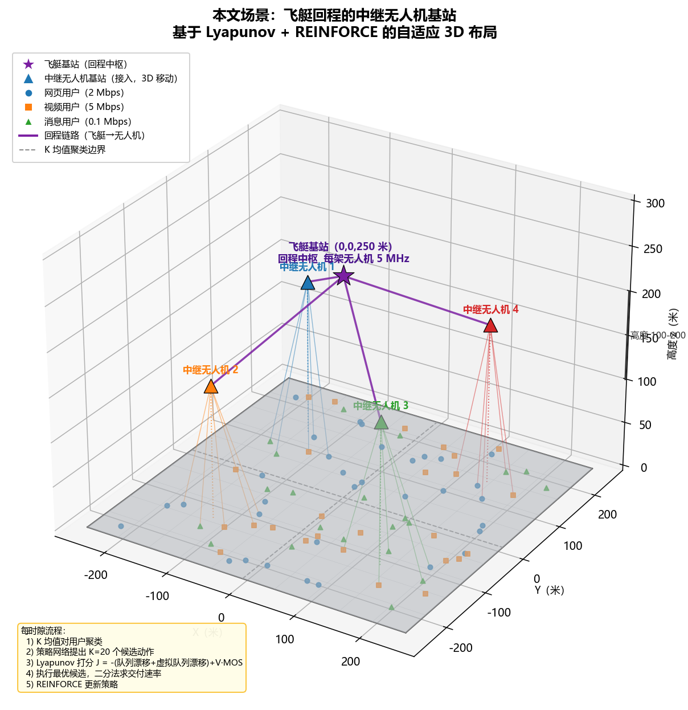

# UAV-BS Placement & Resource Allocation Simulator

基于 [IEEE TON 2025 论文](https://ieeexplore.ieee.org/document/10949495)开源实现的**深度强化学习无人机基站（UAV-BS）3D 放置仿真平台**，在 v13b 修改版之上进一步加入了：

- **中继回传架构**：4 架中继无人机 + 1 艘固定空中飞艇（airship），无人机↔飞艇 LoS 回传、无人机↔用户接入
- **多种带宽分配模型**：类型池硬切（基线）、α均分、到达率比例切分，以及按凸优化文档实现的 **BLOCKA 带宽可变模型**（cvxpy 联合求解带宽+交付）
- **SFM 社会力移动模型** 与 **Weibull 业务到达分布**（与原 Gauss-Markov / Pareto 对照）
- **Proposed 混合方法**：候选动作逐个用真实系统模型打分 + Lyapunov 队列控制 + REINFORCE 在线学习
- 一套**补丁-运行-还原**式对比实验脚本与实验结果表

<p align="center">
  <br>
  <em>仿真场景示意：飞艇回传 + 4 中继无人机 + 移动用户</em>
</p>

## 仿真场景

| 项 | 值 |
|---|---|
| 区域 / 用户 | 500×500 m，100 个移动用户 |
| 无人机 | 4 架，高度 100–200 m，水平限速 30 m/s |
| 回传 | 飞艇@250m，接入池 40 MHz、回传池 20 MHz |
| 业务 | 3 类：Web 2.0 / Video 5.0 / Messaging 0.1 Mb/s，ON-OFF + Weibull（或 Pareto）到达 |
| 移动 | Gauss-Markov 或社会力模型（SFM） |
| 时隙 | 1 s，501 槽；决策计算典型耗时 40–80 ms/槽 |
| KPI | 类型加权 MOS（0.35/0.30/0.35）+ 活跃用户平均队列 |

**对比方法**（`main.ipynb`）：`Stationary`（固定放置）、`Centroid`（追质心）、`Proposed`（混合候选打分 + Lyapunov，即论文 DRL 方法的在线零训练改造），另含 Majority / A2C 基线。

## 仓库结构

```
.
├── uav-bs-placement-drl-modified-v13b-K20-s11/    # 核心仿真项目
│   ├── main.ipynb                                 # 主仿真 notebook（三方法循环 + KPI 导出）
│   ├── params_sys.py                              # 系统参数、输出目录命名（folder tag）
│   ├── blocka_optimizer.py                        # ★ BLOCKA 变带宽凸优化求解器（cvxpy/CLARABEL）
│   ├── mobility_model.py GM 模型 + generate_mobility_SFM（社会力）
│   ├── traffic_model.py ON-OFF 生成 + generate_arrival_from_schedule（Weibull）
│   ├── relay_hybrid_controller.py Proposed：候选打分 + REINFORCE
│   ├── relay_lyapunov_controller.py Lyapunov 交付子问题（临界价格二分）
│   ├── channel_model.py / utils_sys.py / utils_plot.py / utils.py
│   └── simulation/ sim-input（输入 xlsx）/ sim-output（KPI 与图表）
│
├── run_*_comparison.py 对比实验脚本（补丁→运行→还原→收集）
│   run_sfm_comparison.py GM vs SFM 移动
│   run_weibull_comparison.py Pareto vs Weibull 业务
│   run_blocka_comparison.py 固定带宽 vs BLOCKA 变带宽
│   run_alpha_comparison.py 三种分配规则 + BLOCKA 四方案
│   run_ratepool_comparison.py 到达率比例切分（四方案之一）
│
├── *_results.xlsx 实验结果表
├── scenario_schematic.py/png 场景示意图
└── patch_*.py / run_ksigma_sweep.py 历史改造与调参脚本
```

## 环境与运行

**环境**：Python 3.9 + TensorFlow 2.10.1、numpy 1.23.5、scikit-learn、torch、cvxpy ≥1.7、pandas/matplotlib/seaborn/openpyxl、jupyter。

```bash
conda create -n uav-drl python=3.9
conda activate uav-drl
pip install tensorflow==2.10.1 torch scikit-learn pandas matplotlib seaborn \
 openpyxl imageio "cvxpy>=1.7" jupyter nbconvert
# 注意：不要安装 osqp（与 sklearn + cvxpy 同进程导入会段错误），
# blocka_optimizer 默认用 CLARABEL 求解，不需要 osqp。
```

**跑主仿真**：

```bash
cd uav-bs-placement-drl-modified-v13b-K20-s11
jupyter nbconvert --to notebook --execute main.ipynb \
 --output main_executed.ipynb --ExecutePreprocessor.kernel_name=uav-drl
```

也可直接打开 `main.ipynb` 交互运行。KPI 导出在 `simulation/sim-output/<folder tag>/*-kpis-over-time.xlsx`。

**跑对比实验**（每个脚本自动：备份 → 修改 cell 与 folder tag → 执行整本 notebook → 收集 KPI → 还原基线）：

```bash
python run_blocka_comparison.py # 固定带宽 vs BLOCKA 变带宽（SFM+Weibull）
python run_alpha_comparison.py # α均分 / 类型池 / BLOCKA 四方案
python run_ratepool_comparison.py # 到达率比例切分加入四方案
python run_sfm_comparison.py # 移动模型 GM vs SFM
python run_weibull_comparison.py # 业务分布 Pareto vs Weibull
```

- 输入数据（SFM 位置 `*-sfm.xlsx`、Weibull 到达 `dist=weibull`）存在则直接复用，不存在自动生成，全脚本 `np.random.seed(0)` 可复现。
- 中断保护：脚本用 `try/finally` 还原 `main.ipynb` 与 `params_sys.py`；若进程被强制杀死，请手动还原或重跑。

## 带宽分配模型（本仓库核心实验对象）

| 规则 | 做法 | 输出目录后缀 |
|---|---|---|
| 类型池 30/60/10（基线） | 40MHz 按 Web/Video/Msg 切 30/60/10，池内活跃用户均分；回传固定 5MHz/机、超发截断 | `-sfm-wb` |
| α均分 | 整池在全部活跃用户间均分（原版 alpha 规则放大到 40MHz） | `-sfm-wb-alpha` |
| 到达率比例 | 类型池按 μ 比例 28.2/70.4/1.4%（2.0:5.0:0.1） | `-sfm-wb-ratepool` |
| **BLOCKA 变带宽** | 每槽解凸问题 max ΣβᵢDᵢ，联合求接入 W_{u,i}、回传 W_{u,a}、交付 Dᵢ（凹速率 W·log₂(1+Γ/W)，cvxpy+CLARABEL，~16ms/槽） | `-sfm-wb-blocka` |

## 主要实验结果（SFM + Weibull，加权 MOS）

| 方法 | 类型池 | α均分 | 到达率比例 | **BLOCKA** |
|---|---|---|---|---|
| Stationary | 2.670 | 3.499 | 1.880 | **4.176** |
| Centroid | 3.313 | 3.731 | 2.719 | **4.851** |
| Proposed | 3.950 | 3.296 | 3.841 | **5.000** |

- **BLOCKA 全面最优**：固定切分无论怎么调都是妥协，联合动态优化数量级领先（队列积压 Proposed 从 14.3→0.05 Mb）。
- 固定规则互有胜负：α均分在弱放置方法下更好但饿死 Video（MOS≈1.2），类型池保护视频但浪费池；按到达率比例切反而平均最差（带宽需求 ≠ 到达率之比）。

其他对照（详见 `*_results.xlsx`）：

- **移动模型**：SFM vs GM（同为 Pareto 业务：加权 MOS Stationary 2.670 vs 2.616、Centroid 3.374 vs 3.581、Proposed 3.941 vs 4.292）
- **业务分布**：Weibull vs Pareto 对 KPI 影响很小（±0.02），移动模型影响（±0.35）远大于分布形状
- **速度开销**：变带宽 vs 固定带宽的决策耗时 ~10 倍（1.6 vs 16.4 ms/槽），但整槽决策只慢 1.2–1.5 倍，1s 时隙余量充足

## 引用

本实现基于以下论文，使用时请引用：

```bibtex
@ARTICLE{10949495,
  author={Hoang, Linh T. and Nguyen, Chuyen T. and Le, Hoang D. and Pham, Anh T.},
  journal={IEEE Transactions on Networking},
  title={Adaptive 3D Placement of Multiple UAV-Mounted Base Stations in 6G Airborne Small Cells With Deep Reinforcement Learning},
  year={2025},
  doi={10.1109/TON.2025.3552097}}
```
